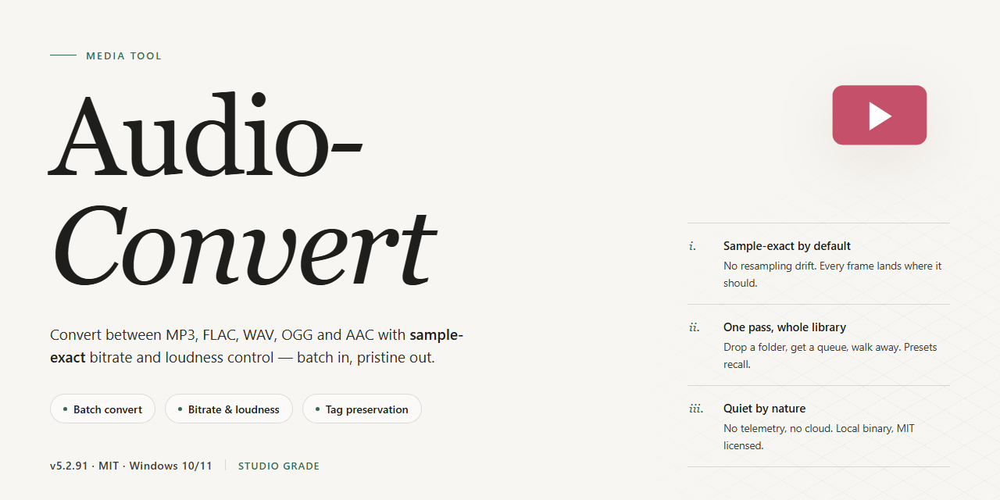

# 🎛️ Audio-Convert: Craft Your Sound, Streamline Your Workflow — Video Tool

### ⌨️ PowerShell Command Button

   

---

Audio-Convert tunes your media library like a careful engineer at the mixing desk — feed it WMA, RM, or other stubborn formats and watch them resolve into clean, playback-ready MP3 files. The workflow stays visual from start to finish: drop in your files, set the output, preview before you commit, and batch the rest so a whole folder moves through in one pass. Every step is built for Windows users who care about speed without sacrificing the character of the original sound. Whether you're archiving a collection or prepping tracks for a device that only speaks MP3, Audio-Convert keeps the path from source to output short and clear.

## 📋 System Requirements

- Windows 10 or Windows 11
- PowerShell 5.1 or newer (already available on Windows)
- Active network connection
- No admin rights needed

## Features

**Format Freedom at a Glance**
- Convert WMA, RM, RA, RMVB, ASF, WMV, and MOV into clean, universally playable MP3.
- One consistent output target means your library finally speaks a single language.
- Quality stays intact through the whole trip — what goes in is what comes out, only lighter and more portable.

**Batch Your Whole Library in One Sweep**
- Drop in a folder, walk away, come back to a finished conversion queue.
- Stack dozens of files and let them process back-to-back instead of one agonizing click at a time.
- Perfect for migrating an old media collection or prepping a playlist for a long drive.

**Preview Before You Commit**
- Listen to the source file right inside the tool before anything is written to disk.
- Catch a bad rip or a silent track before it joins your library.
- A small step that saves a lot of cleanup later.

**Tune the Output to Your Ear**
- Adjust output settings to balance file size against audio fidelity.
- Go lean for portable players, go rich for archiving.
- The controls stay out of the way until you want them — beginners convert in two clicks, tinkerers get their dials.

**A Workflow That Stays Out of Your Way**
- Drag in, pick your target, hit convert — the shape of the tool matches the shape of the task.
- Fast processing keeps momentum going when you're converting in bulk.
- Files land where you expect them, ready for the next step in your pipeline.
- Windows-native feel, so it behaves like the rest of your desktop rather than fighting it.

**Built to Keep Improving**
- Regular updates sharpen speed, polish the interface, and widen format coverage.
- New capabilities arrive without breaking the flow you already know.
- What you download today keeps getting better tomorrow.

## How it works

Audio-Convert treats conversion as a simple visual workflow: drop in the files you already have, watch them line up, and let the tool carry each one across the finish line as a clean MP3.

1. **Bring your audio in.** Point Audio-Convert at the files you want to transform — WMA, RM, and the other formats the app recognizes — and they appear as a tidy list ready for action. No command syntax, no manual encoding setup.
2. **See your queue at a glance.** Every file you add gets its own row with its current format marked, so you always know what's being converted and what's still waiting. The interface reads like a checklist, not a control panel.
3. **Pick MP3 as the destination.** Choose MP3 as your output format and the tool handles the heavy lifting in the background, preserving as much of the original sound as the format allows. What was locked inside an older or less portable container comes out ready to play anywhere.
4. **Tune the output to taste.** Adjust the quality settings before you commit, so the result matches how you actually listen — smaller files for a packed library, higher fidelity for archiving.
5. **Run the whole batch at once.** Hit convert and watch the progress move across every row. Multiple files travel together, so a folder of WMA and RM tracks becomes a folder of MP3s in a single pass instead of one painful file at a time.
6. **Preview before you commit.** Listen to a file right inside the app to confirm it sounds the way you expect before sending the whole batch through.
7. **Collect your finished files.** Once the progress bars settle, your converted MP3s are waiting in the output location you chose — named consistently, ready to sync, share, or drop into your media player.

The rhythm stays the same whether you're converting one track or a hundred: add, choose, convert, done. Audio-Convert keeps the steps visible and the waiting short, so format headaches turn into a quick visual routine rather than a technical chore.

## Workflow

Audio Convert keeps the journey short and visual: drop in a file, pick a destination format, and watch the conversion unfold. No detours, no clutter — just a clean path from source audio to finished MP3.

**1. Bring your audio in.** Drag files straight into the main window or browse for them from your drive. Audio Convert accepts the usual suspects — WMA and other Windows Media files, RM and RA from Real Media, MOV from QuickTime — and lines them up in a tidy conversion queue so you can see everything at a glance.

**2. Choose your target.** Select MP3 as the output format and dial in the quality settings that match your listening needs. The interface keeps these choices front and center, so you always know exactly what you're about to create before anything happens.

**3. Preview before you commit.** Give each track a quick listen right inside the tool. This is the moment to confirm the file is the one you meant, catch a mislabeled track, and adjust output settings if something feels off. What you hear is what you'll get.

**4. Hit convert.** One click sends the whole batch through the conversion engine. A progress view tracks each file as it moves from original format to finished MP3, so you can step away or keep working while the queue empties out.

**5. Collect your results.** Finished files land in your chosen destination folder, ready to play, sync, or archive. The originals stay untouched — Audio Convert works alongside your library, never over it.

**Working with a big batch?** The workflow scales without extra effort: load dozens of files at once, set your output preferences a single time, and let the queue run. It's the same five steps whether you're converting one track or a whole collection.

**A rhythm worth repeating:** preview, convert, verify. That simple loop keeps your library consistent and your conversions predictable — and it's the same loop Audio Convert is built around from the first drag-and-drop to the final saved MP3.

## FAQ

**Is Audio Convert really free?**

Completely. Every feature is unlocked from the first launch — no watermarks, no feature gates, no surprise upgrade prompts halfway through a conversion.

**Which formats can I feed into it?**

Audio Convert handles the awkward ones you probably have sitting in an old folder somewhere: WMA and other Windows Media files, RM and RA Real Media clips, and MOV files from QuickTime. The output lands as clean MP3, so everything plays nicely on modern devices.

**Can I convert a whole batch at once?**

Yes — and this is where the tool really earns its keep. Drop in an entire folder of mismatched files, set your output preferences once, and walk away. Come back to a tidy stack of MP3s instead of clicking through a hundred individual conversions.

**What happens to my audio quality?**

The conversion keeps the original sound intact, with minimal loss even on compressed source files. If you want finer control, adjust the output settings before you hit convert — or preview a track first to hear exactly what you'll get.

**Where do my converted files end up?**

You choose the destination folder before conversion starts, so nothing gets lost in a default directory. Keep originals and outputs separate, and your library stays organized from the very first batch.

**Do I need to worry about my files or privacy?**

No. Conversion happens locally on your Windows machine — your audio never leaves your computer, and nothing is uploaded anywhere.

**How do I remove it if I ever need to?**

Head to Control Panel, open Programs, choose Uninstall a program, select Audio Convert, and click Uninstall. Clean and simple, just like the rest of the workflow.

**Something's not converting the way I expect — what should I try?**

Double-check the source file plays correctly in a media player first, confirm you've selected the right output folder, and make sure you're running the latest release. Most hiccups trace back to a locked file or an outdated build.

## License

Audio Convert is released as a **full free version** — every conversion path, every output preset, and every future update is unlocked from the first launch. No watermarks stamped onto your MP3s, no nag screens interrupting a batch run, no feature held back behind a paywall.

Think of the license as the canvas behind the workflow: you are free to convert WMA, RM, and the rest of your library to MP3 for personal and professional projects alike, drop the tool into your daily routine, and shape your output settings however your ears demand. The only brushstroke we ask you to respect is the boundary of the software itself — don't repackage, resell, or rebrand Audio Convert as your own product.

In short: **free to use, free to keep, free to convert** — the workflow stays open, and so does the door to every update.